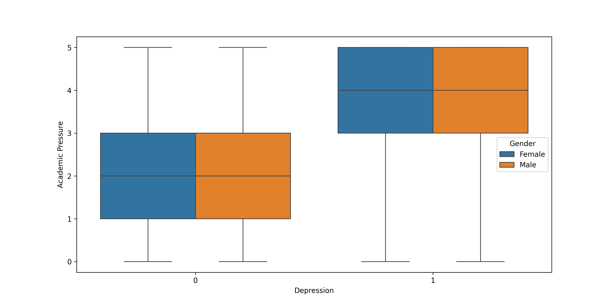
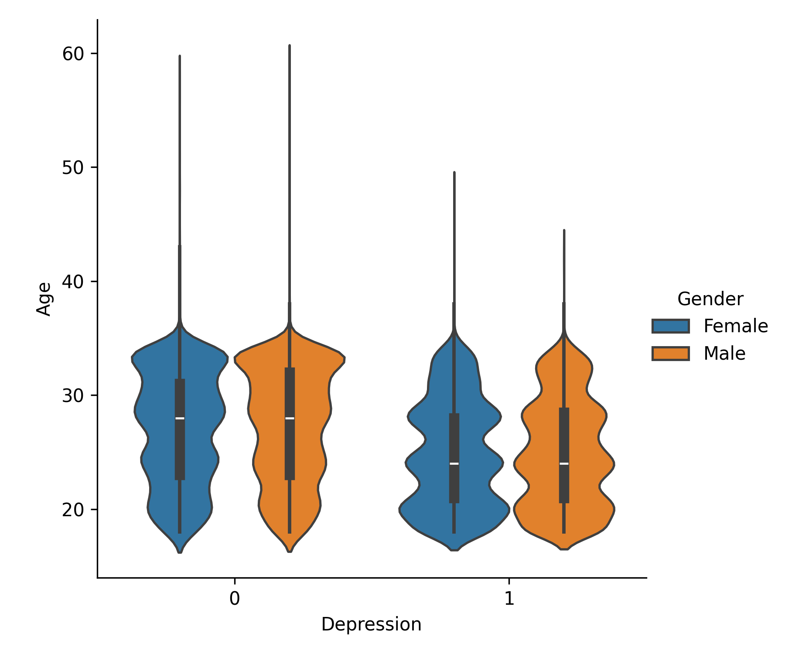
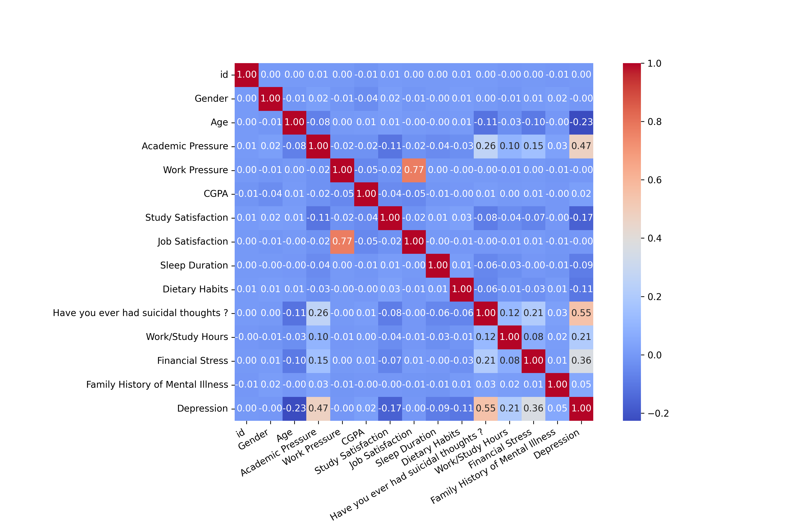
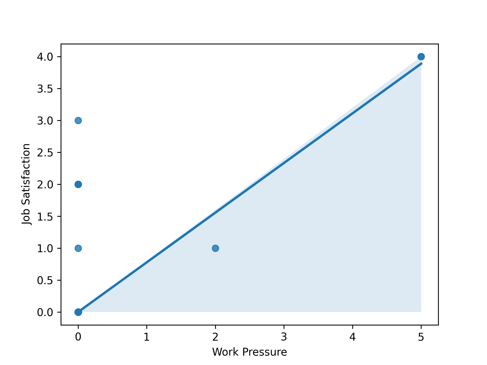
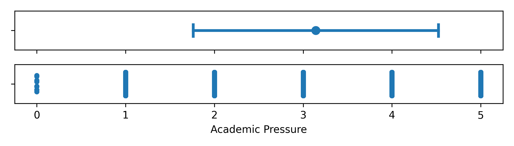
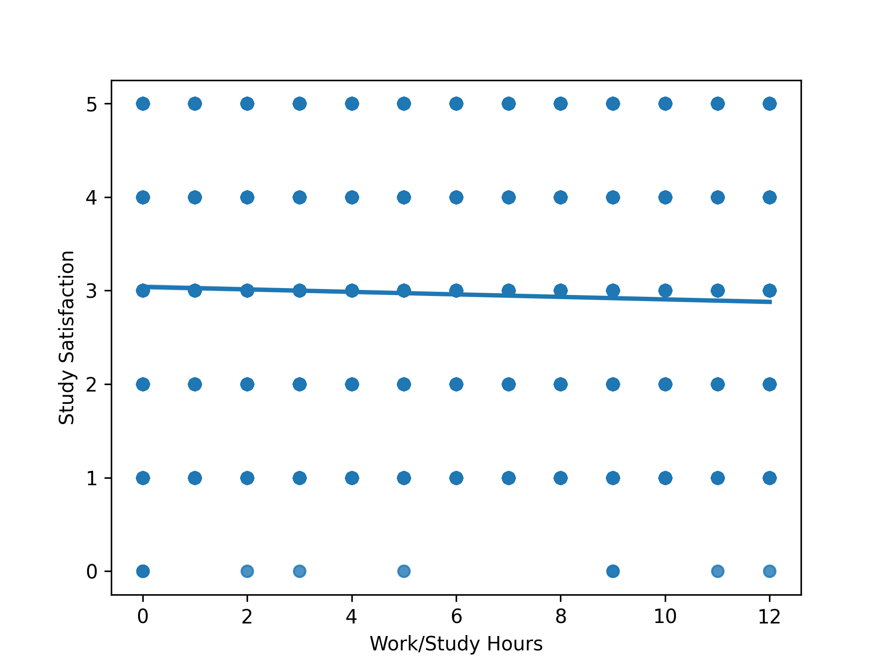
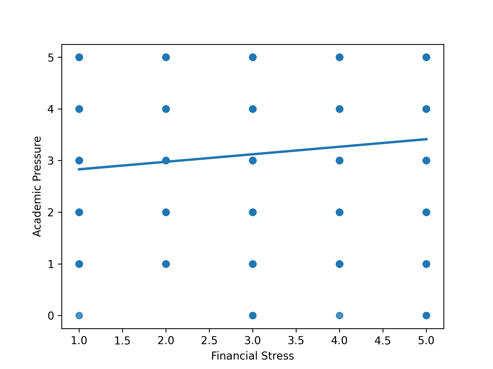

# Depression Prediction and Analysis Among Students


**Author:** Volodymyr Haideichuk

---


## 📘 Project Overview

This project explores the causes and patterns of depression among students and develops predictive machine learning models to assess mental health risk. The study focuses on relationships between sleep duration, dietary habits, financial stress, academic and work pressure, suicidal thoughts, CGPA, and satisfaction levels. The analysis is performed on a structured dataset containing both numerical and categorical variables.

> **Social Impact:** By uncovering key risk factors and predictive patterns, this project aims to inform mental health interventions and raise awareness about student well-being. Ethical interpretation and responsible use of findings are emphasized throughout.

---

## Motivation & Background

Mental health issues, especially depression, are increasingly prevalent among students. Understanding the underlying factors can help inform interventions and support systems. This project combines data science and machine learning to provide actionable insights and promote mental health awareness.

---

## 📂 Dataset Description

- **Source:** kaggle.com
- **Features:**
  - Demographics: Age, Gender, City, Profession
  - Lifestyle: Sleep Duration, Dietary Habits, Work/Study Hours
  - Academic: Academic Pressure, Study Satisfaction, CGPA
  - Financial: Financial Stress
  - Mental Health: Depression, Suicidal Thoughts, Family History
- **Format:** Mixed numerical and categorical

---


## 📊 Exploratory Data Analysis & Visualizations (Part 1)

The first stage focuses on exploratory data analysis and identifying correlations between student lifestyle factors and depression levels.

**Implemented visualizations:**
- Boxplots and Violinplots (age, gender, sleep, dietary habits)
- Histograms and conditional histograms (sleep duration, depression distribution)
- Error bars for statistical comparison
- Heatmap for feature correlation
- Linear regression plots for relationships such as:
  - Financial Stress ↔ Academic Pressure
  - Work Hours ↔ Study Satisfaction
  - Job Satisfaction ↔ Work Pressure

<p align="center">
  
  
  
  
</p>

#### Key Findings

- Depression is most prevalent among students aged 20–30.
- Over 50% of participants reported depressive symptoms.
- Strong correlation between financial stress, academic pressure, and depression.
- Students exceeding 10 study/work hours daily are at higher risk of suicidal thoughts.
- Gender shows no statistically significant effect on depression likelihood.

---


## 🧩 Machine Learning Models (Part 2)

The second part introduces machine learning models to predict depression (Yes/No) and continuous outcomes such as CGPA.

**Data preprocessing pipeline:**
- OneHotEncoder for categorical encoding
- StandardScaler for normalization
- SimpleImputer for missing values

**Implemented models:**
- Custom Logistic Regression
- Custom Linear Regression (CGPA prediction)

---


## 📈 Model Performance

| Model                | Dataset     | Accuracy | Cross-Entropy (CE) |
|----------------------|-------------|----------|--------------------|
| Logistic Regression  | Train       | ~0.85    | 0.35               |
| Logistic Regression  | Validation  | ~0.86    | 0.33               |
| Logistic Regression  | Test        | ~0.83    | 0.36               |
| Decision Tree        | Test        | ~0.81    | 0.44               |
| SVM                  | Test        | ~0.83    | 0.37               |

*Both custom and library Logistic Regression models showed nearly identical results, indicating proper understanding and implementation of optimization and loss functions.*

---


---

## 📈 Model Evaluation & Optimization (Part 3)

The final part introduces cross-validation, loss analysis, and model convergence evaluation.

- **3-fold cross-validation** achieved ~0.847 accuracy and low CE variance (±0.004).
- The model demonstrated consistent generalization and no overfitting.
- Convergence plots show stable reduction in loss across epochs for training data.
- Error analysis indicated minor divergence between test and train losses due to dataset variability.

<p align="center">
  
  
  
</p>

---


---

## 🏆 Results & Insights

- **Depression is most prevalent among students aged 20–30.**
- **Over 50% of participants reported depressive symptoms.**
- **Financial stress and academic pressure are the strongest predictors of depression.**
- **Students exceeding 10 study/work hours daily are at higher risk of suicidal thoughts.**
- **Gender is not a significant predictor of depression in this dataset.**

The models achieved high accuracy and generalization, with custom implementations matching library results. Visualizations and convergence plots confirm robust training and reliable predictions.

---

## 💡 Technical Highlights

- Complete ML workflow: data cleaning → visualization → feature engineering → model building → evaluation → optimization
- Custom implementations for Logistic and Linear Regression
- Consistent and interpretable metrics across all experiments
- Use of real-world mental health data with ethical considerations in interpretation

---


## 🧰 Technologies & Tools Used

- Python, pandas, NumPy, scikit-learn
- matplotlib, seaborn for visualization
- PyTorch for GPU-accelerated logistic regression

---


## 🚀 How to Run the Project

1. **Clone the repository:**
  ```bash
  git clone https://github.com/Volodymyr1233/MSID_PROJECT_FULL.git
  cd MSID_PROJECT_FULL
  ```
2. **Install dependencies:**
  ```bash
  pip install -r part_1/requirements.txt
  ```
3. **Run data analysis & visualization:**
  ```bash
  cd part_1
  python data_analysis_main.py
  ```
4. **Test machine learning models:**
  ```bash
  cd ../part_2
  python test.py
  ```
5. **Evaluate models:**
  ```bash
  cd ../part_3
  python calc_acc.py
  ```

---
*This project is for educational purposes.*
